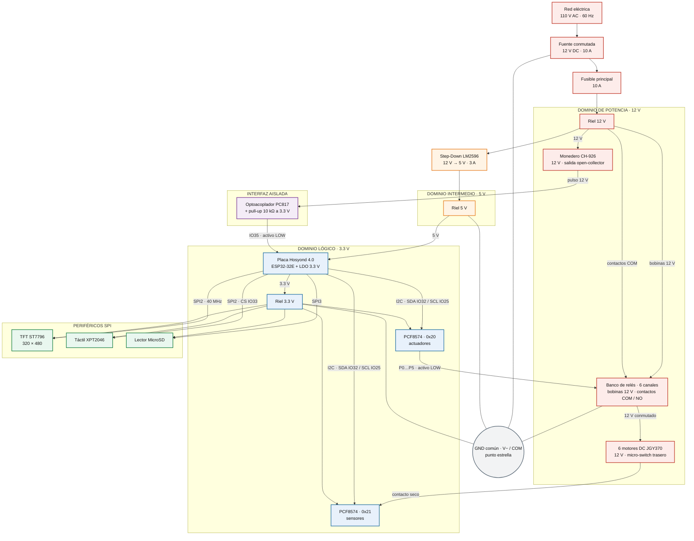
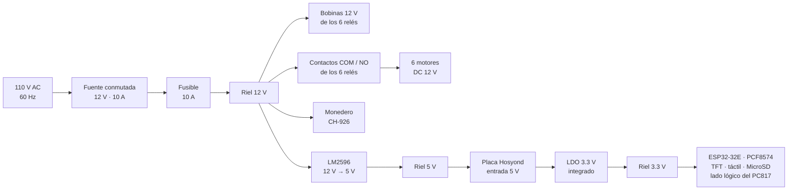

# Arquitectura de Hardware — Máquina Expendedora Automática de 6 Canales

**Versión 1.1 · 26 de octubre de 2026 · Placa base Hosyond 4.0" (ESP32-32E)**

> **Nota de alcance.** Este documento describe exclusivamente el dominio físico del sistema: voltajes, corrientes, estados lógicos, protecciones, conectores y topología de interconexión. El comportamiento del sistema y la lógica de control se documentan por separado.

## 1. Mapa Conceptual del Hardware (Diagrama de Bloques)

### 1.1 Dominios funcionales

| Dominio | Tensión | Función |
| :--- | :--- | :--- |
| **Potencia** | 12 V DC | Monedero, bobinas de relé, contactos de relé, motores y entrada del buck converter |
| **Intermedio** | 5 V DC | Únicamente la entrada de 5 V de la placa base Hosyond |
| **Lógico** | 3.3 V DC | ESP32-32E, expansores I2C y lógica de pantalla/táctil/SD |
| **Interfaz aislada** | 12 V → 3.3 V | Adaptación del pulso del monedero mediante optoacoplador |
| **Periféricos SPI** | 3.3 V DC | Panel TFT, táctil resistivo y almacenamiento MicroSD |

### 1.2 Lectura del diagrama

1. **El cerebro del sistema** es la placa Hosyond 4.0" con módulo **ESP32-32E**. Integra el regulador que genera el riel lógico de 3.3 V, el conector de pantalla y los puertos de expansión JST.
2. **La potencia no pasa por el ESP32.** El microcontrolador solo entrega señales de control de baja corriente a los expansores I2C; la conmutación de los 12 V la realizan los contactos de los relés.
3. **El monedero está eléctricamente separado** de la lógica mediante un optoacoplador PC817. El pulso de 12 V se convierte en una señal de 3.3 V compatible con el pin IO35.
4. **Los dos expansores PCF8574 comparten un único bus I2C** y se diferencian por dirección: `0x20` para actuar sobre los relés, `0x21` para leer los fines de carrera.
5. **Los periféricos SPI no comparten bus entre sí**: la pantalla y el táctil usan SPI2; la MicroSD usa SPI3.
6. **El riel de 5 V es exclusivo de la placa base.** El LM2596 no alimenta relés ni motores; solo entrega los 5 V que la placa Hosyond convierte internamente a 3.3 V.

### 1.3 Identificación de la placa base

**Figura 1 — Placa base Hosyond 4.0" (ESP32-32E)**

*Descripción técnica:* placa integrada que combina el módulo ESP32-32E, el panel TFT ST7796 de 4.0 pulgadas, el controlador táctil XPT2046, el lector MicroSD y los puertos de expansión. Es la única fuente del riel de 3.3 V del sistema.

*Qué debe mostrar la fotografía:* vista frontal y posterior de la placa, identificación serigrafiada de los puertos **I2C Peripheral Interface** y **Expand the input pin**, ubicación del conector de alimentación y del regulador lineal.

**Figura 2 — Cableado general del conjunto**

*Descripción técnica:* vista general del mazo de cables con separación física entre el recorrido de potencia (12 V) y el recorrido de señales (I2C, SPI, pulso de monedero).

*Qué debe mostrar la fotografía:* canaleta o amarres que separen los conductores de 12 V de los de señal, borneras de distribución, punto de unión de tierras y ubicación de los fusibles.

---

## 2. Árbol de Alimentación (Power Tree)

### 2.1 Topología de distribución

### 2.2 Definición de rieles

| Riel | Origen | Tolerancia | Consumidores | Corriente estimada | Observaciones |
| :--- | :--- | :--- | :--- | :--- | :--- |
| **12 V** | Fuente conmutada 110 V AC → 12 V DC | ±5 % | Monedero CH-926; bobinas de los 6 relés; contactos COM/NO; entrada del LM2596 | 0.2 A en reposo; 0.3–1.0 A por motor; 2–3 A de arranque | Riel inductivo y ruidoso. Requiere desacoplo y protección contra picos. |
| **5 V** | Step-Down LM2596 | ±3 % | Entrada de 5 V de la placa Hosyond | 0.35–0.55 A | Exclusivo de la placa base; no alimenta relés ni motores. |
| **3.3 V** | Regulador lineal de la placa Hosyond | ±2 % | ESP32-32E; PCF8574; TFT; táctil; MicroSD; salida del PC817 | 0.3–0.6 A | **No** alimentar los PCF8574 a 5 V. |

> **⚠️ Nota de diseño — Tres niveles en el módulo de relés.** Las **bobinas** y los **contactos** operan a **12 V**; las **entradas de control IN1–IN6** son de nivel lógico y se conectan al PCF8574 a **3.3 V**. La bobina no se alimenta desde el riel de 5 V ni desde el ESP32.

### 2.3 Criterios de distribución

- **Separación de dominios.** El riel de 12 V alimenta el monedero, las bobinas y contactos de los relés, los motores y la entrada del buck converter. Ningún componente lógico se alimenta directamente de 12 V.
- **Conversión en cascada.** 12 V → 5 V (LM2596) → 3.3 V (LDO de la placa). El riel de 5 V se reserva exclusivamente para la entrada de la placa base.
- **Unión de tierras en punto estrella.** "Unir las tierras" significa llevar al mismo punto físico el **GND lógico del ESP32**, el **GND de salida del buck converter** y el **GND del módulo de relés de 12 V**. Los tres conductores se empalman y se atornillan juntos al **terminal negativo (V− / COM) de la fuente principal de 12 V**. Así, todas las señales de control (I2C, pulso del monedero, entradas de relé y sensores) comparten exactamente la misma referencia de 0 V y no aparecen diferencias de potencial entre módulos.

| Elemento | Conductor | Punto de unión |
| :--- | :--- | :--- |
| GND lógico del ESP32 / placa Hosyond | 22 AWG, negro | Borne V− / COM de la fuente |
| GND de salida del LM2596 | 22 AWG, negro | Borne V− / COM de la fuente |
| GND del módulo de relés (12 V) | 18–20 AWG, negro | Borne V− / COM de la fuente |
| GND del monedero CH-926 | 20 AWG, negro | Borne V− / COM de la fuente |
| Retorno de los motores | 18 AWG, negro | Borne V− / COM de la fuente |

> **Cómo se arma físicamente.** Los conductores de retorno se pelan, se empalman en una bornera o terminal de ojo y se atornillan al borne **V− / COM** de la fuente. No se usa el chasis metálico como conductor de retorno ni se encadenan las tierras de módulo en módulo: todos los retornos convergen en el mismo tornillo.

- **Desacoplo.** Se recomienda un capacitor de **1000 µF / 25 V** a la salida de la fuente, **470 µF / 25 V** junto al banco de relés y **100 nF** entre VCC y GND de cada PCF8574.
- **Calibre de conductores.** 18 AWG para 12 V de motores y bobinas; 20–22 AWG para 5 V y 3.3 V; 24 AWG para señales I2C, SPI y pulso de monedero.
- **Protección.** Fusible de 10 A en la línea principal de 12 V. Se recomienda además protección contra inversión de polaridad en la entrada de la fuente.

> **⚠️ Nota de diseño — Aislamiento funcional, no de seguridad.** El PC817 separa el pulso del monedero del pin del ESP32 y elimina ruido de modo común, pero ambos lados comparten el mismo negativo de la fuente de 12 V. Por tanto, **no constituye aislamiento galvánico de seguridad**; no debe usarse como barrera contra contacto eléctrico.

### 2.4 Presupuesto de corriente

| Riel | Carga | Corriente típica | Pico estimado | Base del cálculo |
| :--- | :--- | ---: | ---: | :--- |
| 12 V | Monedero CH-926 | 0.10 A | 0.20 A | Consumo en reposo y durante aceptación |
| 12 V | Motor JGY370 (1 activo) | 0.40 A | 2.50 A | Corriente de arranque con carga mecánica |
| 12 V | Bobina de relé 12 V (1 activa) | 0.04 A | 0.05 A | Relé tipo SRD-12VDC |
| 12 V | Entrada del LM2596 | 0.45 A | 0.80 A | Equivalente de la carga de 5 V |
| **12 V** | **Total del riel** | **≈ 1.0 A** | **≈ 3.6 A** | Fuente de 10 A: margen > 2.7× |
| 5 V | Placa Hosyond | 0.35 A | 0.55 A | Lógica + retroiluminación |
| **5 V** | **Total del riel** | **≈ 0.35 A** | **≈ 0.55 A** | LM2596 de 3 A: margen > 5× |
| 3.3 V | ESP32-32E | 0.12 A | 0.24 A | Pico de radio deshabilitado |
| 3.3 V | PCF8574 ×2 | 0.002 A | 0.004 A | Consumo cuasiestático |
| 3.3 V | TFT + táctil + MicroSD | 0.15 A | 0.25 A | Panel y retroiluminación |
| **3.3 V** | **Total del riel** | **≈ 0.30 A** | **≈ 0.50 A** | LDO: margen térmico según encapsulado |

*Los valores son estimaciones de diseño basadas en hojas de datos típicas de los componentes seleccionados.*

**Figura 3 — Fuente de alimentación principal**

*Descripción técnica:* fuente conmutada de 110 V AC a 12 V DC con capacidad mínima de 10 A, responsable del dominio de potencia.

*Qué debe mostrar la fotografía:* placa de características de la fuente, borneras de salida, fusible instalado y punto de unión del negativo con el resto del sistema.

**Figura 4 — Conversión a 5 V**

*Descripción técnica:* módulo reductor 12 V → 5 V basado en LM2596, con potenciómetro de ajuste y disipador. Su salida alimenta únicamente la entrada de 5 V de la placa base.

*Qué debe mostrar la fotografía:* potenciómetro de ajuste, disipador instalado y borneras de entrada/salida identificadas.

---

## 3. Acondicionamiento de Señales y Lógica de Hardware

### 3.1 Convención industrial Active LOW

Toda la máquina adopta la convención **activo en nivel BAJO**: el estado de reposo es nivel alto y la activación se produce al llevar la señal a 0 V (GND).

| Señal | Estado en reposo | Estado activo | Mecanismo físico |
| :--- | :--- | :--- | :--- |
| **Pulso de monedero (IO35)** | HIGH ≈ 3.3 V | LOW ≤ 0.4 V | Optoacoplador conduce y hunde la línea |
| **Fin de carrera (0x21)** | HIGH ≈ 3.3 V | LOW ≤ 0.4 V | Micro-switch cierra a GND |
| **Entrada de relé (0x20)** | HIGH ≈ 3.3 V | LOW ≤ 0.4 V | LED del opto interno conduce y excita la bobina |

**Ventajas de esta convención:**

- **Inmunidad al ruido.** Un cable desconectado o una soldadura fría tienden a quedar en alto por el pull-up, no a generar activaciones falsas.
- **Compatibilidad con salidas open-collector / open-drain.** El monedero y los expansores PCF8574 hunden corriente a GND; no necesitan entregar tensión.
- **Seguridad ante fallo.** En los sensores, un circuito abierto se interpreta como "fuera de reposo" y el motor se detiene por límite de tiempo en lugar de girar indefinidamente. En los relés, la pérdida de la señal de control deja la bobina desenergizada y el motor apagado.
- **Estandarización.** Todo el sistema se diagnostica con la misma regla: **0 V = activo**.

### 3.2 Monedero CH-926 con optoacoplador PC817

**Cadena de señal:**

> **Monedero CH-926** (12 V) → **PC817** (aislado) → **Pull-up 10 kΩ** (a 3.3 V) → **IO35** (entrada)

| Etapa | Componente | Estado inactivo | Estado activo |
| :--- | :--- | :--- | :--- |
| Salida del monedero | Transistor NPN open-collector | Abierto (no conduce) | Cierra a GND de 12 V |
| Entrada del opto | LED infrarrojo + resistencia limitadora | Apagado | Encendido, IF ≈ 5–10 mA |
| Salida del opto | Fototransistor | Corte | Saturación, VCE ≈ 0.2 V |
| Línea de señal | Pull-up 10 kΩ a 3.3 V | 3.3 V (HIGH) | ≈ 0.2–0.4 V (LOW) |
| Pin del ESP32 | IO35, solo entrada | Sin evento | Flanco de bajada |

**Dimensionamiento de la resistencia de entrada.** Para una fuente de 12 V, una caída directa del LED de ≈ 1.2 V y una corriente objetivo de 8 mA:

> **R = (12 V − 1.2 V − 0.2 V) / 8 mA ≈ 1.3 kΩ** → valor comercial: **1.2 kΩ**

El módulo HiLetgo integra esta resistencia; el cálculo se incluye como referencia de diseño.

**Pull-up de salida.** El pin **IO35 es de solo entrada y no dispone de pull-up interno**. La resistencia física de **10 kΩ a 3.3 V** es obligatoria para definir el nivel alto y evitar lecturas flotantes. Con 10 kΩ y la capacidad típica del cableado, el tiempo de subida es del orden de microsegundos, muy inferior a la duración de los pulsos del monedero (decenas de milisegundos).

**Asignación de pulsos por moneda:**

| Moneda | Pulsos | Valor |
| :--- | ---: | ---: |
| RD$ 1 | 1 | RD$ 1.00 |
| RD$ 5 | 3 | RD$ 5.00 |
| RD$ 10 | 5 | RD$ 10.00 |
| RD$ 25 | 7 | RD$ 25.00 |

**Figura 5 — Acondicionamiento del monedero**

*Descripción técnica:* módulo optoacoplador HiLetgo de 2 canales basado en PC817. El canal 1 se usa para el pulso del monedero; el canal 2 queda de reserva.

*Qué debe mostrar la fotografía:* identificación de IN1/OUT1, resistencia limitadora de entrada, bornera de 3.3 V/GND del lado lógico y la resistencia de 10 kΩ conectada entre OUT1 y 3.3 V.

**Figura 6 — Monedero CH-926**

*Descripción técnica:* validador multimoneda configurable, alimentado a 12 V, con salida de pulsos por transistor open-collector.

*Qué debe mostrar la fotografía:* bornera de alimentación (12 V/GND), línea de salida de pulsos, selección de monedas y sentido de inserción.

### 3.3 Sensores de fin de carrera (módulo 0x21)

Cada motor reductor incorpora un micro-switch que señala una vuelta completa. En su configuración de fábrica, uno de los terminales del switch está unido a la alimentación de 12 V del motor, lo que **destruiría el PCF8574** si se conectara directamente.

**Acondicionamiento obligatorio — contacto seco:**

1. Se corta físicamente la pista de cobre de la placa LK20052 del motor con un bisturí.
2. El micro-switch queda aislado de los 12 V y se convierte en un **contacto seco**.
3. Un terminal se conecta al puerto Pn del expansor `0x21` y el otro a **GND lógico**.
4. Al cerrarse, el switch hunde la entrada a 0 V (LOW). Al abrirse, el puerto vuelve a nivel alto por su fuente de corriente interna.

| Estado del motor | Micro-switch | Puerto 0x21 | Interpretación |
| :--- | :--- | :--- | :--- |
| En reposo (fin de carrera alcanzado) | Cerrado | LOW ≈ 0 V | Canal en posición segura |
| Girando | Abierto | HIGH ≈ 3.3 V | Canal fuera de reposo |

> **⚠️ Nota de diseño — Pull-up externo en cables largos.** El PCF8574 utiliza una fuente de corriente interna muy débil (≈ 100 µA) como pull-up. Con cables de más de 50 cm o ambientes con ruido de motores, se recomienda añadir una resistencia externa de **4.7 kΩ a 3.3 V** por cada entrada de sensor, junto con un capacitor de **100 nF a GND** para filtrar EMI.

**Tiempo máximo de energización por canal:** 10 s. Es un límite de protección térmica del motor y del cableado; si el sensor no confirma el reposo en ese plazo, la bobina del relé debe desenergizarse.

**Figura 7 — Sensores de fin de carrera**

*Descripción técnica:* módulo expansor PCF8574 configurado en dirección `0x21`, con los puertos P0–P5 conectados a los contactos secos de los seis motores.

*Qué debe mostrar la fotografía:* configuración de los DIP switches de dirección, bornera de bus I2C (VCC/GND/SDA/SCL), conexión de los seis hilos de sensor y punto común de GND.

**Figura 8 — Motor reductor y micro-switch**

*Descripción técnica:* motorreductor DC de 12 V con leva de accionamiento y micro-switch trasero para detección de vuelta completa.

*Qué debe mostrar la fotografía:* placa LK20052 con el corte de pista visible, identificación de los terminales del motor y del switch, y montaje mecánico de la leva.

### 3.4 Banco de relés (módulo 0x20)

El banco está formado por **6 canales de relé con bobina de 12 V**, entradas optoacopladas y **activación por nivel bajo**. La bobina se alimenta desde el riel de 12 V a través del borne VCC del módulo. La salida del PCF8574 no alimenta la bobina: solo hunde la corriente del LED del optoacoplador interno (≈ 2–4 mA). La conmutación de la bobina la realiza la electrónica propia del módulo.

| Puerto 0x20 | Entrada del relé | LED interno | Bobina 12 V | Contacto COM–NO | Motor |
| :--- | :--- | :--- | :--- | :--- | :--- |
| HIGH ≈ 3.3 V | Sin corriente | Apagado | Desenergizada | Abierto | Detenido |
| LOW ≈ 0 V | ≈ 2–4 mA | Encendido | Energizada | Cerrado | Alimentado a 12 V |

**Ruta de potencia por canal:**

> **Riel 12 V** → **Fusible** → **COM del relé** → **NO** → **Motor (+)** → **GND de potencia**
>
> **Riel 12 V** → **VCC del módulo** → **Bobina del relé** → **GND del módulo**

**Protecciones recomendadas:**

- **Diodo de rueda libre** en paralelo con cada motor (1N5408 o equivalente, cátodo al positivo) para recortar el pico inductivo al desenergizar.
- **Red RC** de 100 Ω + 100 nF entre contactos COM y NO para amortiguar el arco eléctrico y prolongar la vida del relé.
- **Fusible por canal** o protección térmica si el cableado de motor es de sección reducida.

**Capacidad de contacto.** La corriente de arranque del motor (≈ 2–3 A) debe quedar por debajo de la corriente nominal del contacto del relé. Los módulos comerciales suelen declarar 10 A / 250 V AC, pero el margen real en DC inductivo es menor.

> **⚠️ Nota de diseño — Compatibilidad de la entrada de control.** Las bobinas y los contactos operan a 12 V, pero las entradas IN1–IN6 deben ser compatibles con 3.3 V. En módulos cuyo optoacoplador se referencia al propio riel de 12 V, el nivel alto de 3.3 V puede no garantizar el corte. Para ese caso se intercala un optoacoplador o un driver tipo ULN2803 entre el PCF8574 y el módulo; el expansor no se conecta directamente a una entrada referenciada a 12 V.

**Figura 9 — Banco de relés**

*Descripción técnica:* conjunto de 6 relés con bobina de 12 V, entradas optoacopladas activas en bajo y contactos que conmutan los 12 V de los motores.

*Qué debe mostrar la fotografía:* bornera de entradas IN1–IN6, alimentación de bobinas a 12 V, numeración de los contactos COM/NO y ruta de los conductores de 12 V.

### 3.5 Capa física del bus I2C

| Parámetro | Valor | Justificación |
| :--- | :--- | :--- |
| Frecuencia | 100 kHz | Modo estándar; robusto con cableado largo |
| Nivel lógico | 3.3 V | Compatible con el ESP32-32E sin adaptador |
| SDA | IO32 | Línea de datos, drenador abierto |
| SCL | IO25 | Línea de reloj, drenador abierto |
| Pull-ups | 10 kΩ por módulo (≈ 5 kΩ equivalente) | Dos módulos en paralelo |
| Capacidad máxima de bus | 400 pF | Límite del modo estándar |

**Direccionamiento:**

| Módulo | A2 | A1 | A0 | Dirección de 7 bits | Función |
| :--- | :---: | :---: | :---: | :--- | :--- |
| PCF8574 de actuadores | 0 | 0 | 0 | `0x20` | Escritura de relés |
| PCF8574 de sensores | 0 | 0 | 1 | `0x21` | Lectura de fines de carrera |

> **⚠️ Nota de diseño — Variante del circuito integrado.** El **PCF8574** tiene dirección base `0x20`; el **PCF8574A** tiene dirección base `0x38`. Si los módulos montan la variante "A", las direcciones son `0x38` y `0x39`, y los DIP switches se ajustan en consecuencia.

**Buenas prácticas de cableado:**

- Trenzar SDA y SCL con un retorno de GND y mantener el par alejado de los conductores de motor.
- No superar 1 m de bus sin repetidor; para distancias mayores, usar un buffer I2C o reducir la frecuencia.
- Un capacitor de 100 nF entre VCC y GND en cada módulo, lo más cerca posible del integrado.
- No conectar ni desconectar módulos con el sistema energizado.

**Figura 10 — Bus I2C y expansores**

*Descripción técnica:* conexión en paralelo de los dos módulos PCF8574 al puerto I2C de la placa, con SDA en IO32 y SCL en IO25.

*Qué debe mostrar la fotografía:* recorrido del par SDA/SCL, ubicación de las resistencias de pull-up, configuración de los DIP switches y conexión de VCC a 3.3 V.

---

## 4. Matriz de Conexiones (Pinout Base)

### 4.1 Resumen de pines utilizados del ESP32-32E

| GPIO | Función | Dirección | Riel | Observaciones |
| :--- | :--- | :--- | :--- | :--- |
| **IO2** | TFT — Data/Command (DC) | Salida | 3.3 V | Pin de arranque (*strapping*) |
| **IO5** | MicroSD — CS | Salida | 3.3 V | Pin de arranque (*strapping*) |
| **IO12** | TFT — MISO | Entrada | 3.3 V | Pin de arranque (*MTDI*); no añadir pull-up externo |
| **IO13** | TFT — MOSI | Salida | 3.3 V | — |
| **IO14** | TFT — SCLK | Salida | 3.3 V | Reloj SPI2 a 40 MHz |
| **IO15** | TFT — CS | Salida | 3.3 V | Pin de arranque (*strapping*) |
| **IO18** | MicroSD — CLK | Salida | 3.3 V | SPI3 |
| **IO19** | MicroSD — MISO | Entrada | 3.3 V | SPI3 |
| **IO23** | MicroSD — MOSI | Salida | 3.3 V | SPI3 |
| **IO25** | I2C — SCL | Drenador abierto | 3.3 V | Requiere pull-up |
| **IO27** | TFT — Retroiluminación | Salida PWM | 3.3 V | Control de brillo |
| **IO32** | I2C — SDA | Drenador abierto | 3.3 V | Requiere pull-up |
| **IO33** | Táctil — CS | Salida | 3.3 V | Comparte SPI2 con la TFT |
| **IO35** | Pulso de monedero | **Solo entrada** | 3.3 V | Sin pull-up interno; requiere 10 kΩ externo |
| **EN** | Reset de la placa | Entrada | 3.3 V | Compartido con el reset de la TFT |
| **3V3** | Salida del regulador | Alimentación | 3.3 V | Alimenta expansores y periféricos |
| **5V** | Entrada de alimentación | Alimentación | 5 V | Desde el LM2596 |
| **GND** | Referencia común | — | 0 V | Punto de unión con el retorno de potencia |

> **⚠️ Nota de diseño — Pines de arranque.** IO2, IO5, IO12 y IO15 determinan el modo de arranque del módulo ESP32. La placa Hosyond ya integra el hardware de pantalla y MicroSD sobre estos pines; **no deben añadirse pull-ups ni pull-downs externos** que alteren su estado durante el encendido.

### 4.2 Bus I2C y expansores

| Señal | ESP32-32E | PCF8574 `0x20` | PCF8574 `0x21` | Nivel |
| :--- | :--- | :--- | :--- | :--- |
| SDA | IO32 | SDA | SDA | 3.3 V |
| SCL | IO25 | SCL | SCL | 3.3 V |
| VCC | 3V3 | VCC | VCC | 3.3 V |
| GND | GND | GND | GND | 0 V |
| A0 | — | 0 | 1 | — |
| A1 | — | 0 | 0 | — |
| A2 | — | 0 | 0 | — |

### 4.3 Monedero y optoacoplador

| Origen | Terminal | Destino | Nivel / Nota |
| :--- | :--- | :--- | :--- |
| CH-926 | +12 V | Riel 12 V | 12 V DC |
| CH-926 | GND | GND de potencia | 0 V |
| CH-926 | Salida de pulsos (COIN) | IN1 del PC817 | Open-collector a GND |
| PC817 | VCC (lado lógico) | 3V3 de la placa | 3.3 V |
| PC817 | GND (lado lógico) | GND lógico | 0 V |
| PC817 | OUT1 | IO35 | Activo LOW |
| Resistencia 10 kΩ | Extremo 1 | OUT1 / IO35 | Pull-up obligatorio |
| Resistencia 10 kΩ | Extremo 2 | 3V3 | 3.3 V |

### 4.4 Pantalla TFT ST7796 y táctil XPT2046

| Función | GPIO | Señal | Observaciones |
| :--- | :--- | :--- | :--- |
| Reloj SPI | IO14 | SCLK | Bus SPI2 a 40 MHz |
| Datos MOSI | IO13 | MOSI | Compartido con el táctil |
| Datos MISO | IO12 | MISO | Compartido con el táctil |
| Chip Select TFT | IO15 | CS | Exclusivo del panel |
| Data/Command | IO2 | DC | Alto = datos, bajo = comando |
| Reset TFT | EN | RST | Atado al reset de la placa |
| Retroiluminación | IO27 | BL | PWM de brillo |
| Chip Select táctil | IO33 | CS | Exclusivo del XPT2046 |
| IRQ táctil | — | PENIRQ | No conectado; lectura por sondeo |

### 4.5 Lector MicroSD

| Función | GPIO | Señal | Observaciones |
| :--- | :--- | :--- | :--- |
| Chip Select | IO5 | CS | Bus SPI3 |
| Reloj | IO18 | CLK | Bus SPI3 |
| Datos MOSI | IO23 | MOSI | Bus SPI3 |
| Datos MISO | IO19 | MISO | Bus SPI3 |
| Alimentación | 3V3 | VCC | 3.3 V |
| Referencia | GND | GND | 0 V |

### 4.6 Matriz de canales: relés, motores y sensores

| Canal | PCF8574 `0x20` | Entrada de relé | Contacto | Motor | PCF8574 `0x21` | Sensor |
| :---: | :---: | :---: | :---: | :---: | :---: | :---: |
| **1** | P0 | IN1 | COM1 / NO1 | M1 | P0 | S1 |
| **2** | P1 | IN2 | COM2 / NO2 | M2 | P1 | S2 |
| **3** | P2 | IN3 | COM3 / NO3 | M3 | P2 | S3 |
| **4** | P3 | IN4 | COM4 / NO4 | M4 | P3 | S4 |
| **5** | P4 | IN5 | COM5 / NO5 | M5 | P4 | S5 |
| **6** | P5 | IN6 | COM6 / NO6 | M6 | P5 | S6 |
| — | P6 / P7 | No usado | — | — | P6 / P7 | No usado |

*Los puertos P6 y P7 de ambos expansores deben permanecer en nivel alto para no activar cargas ni sensores fantasma.*

### 4.7 Distribución de borneras y conectores

| Conector | Tipo | Señales | Destino |
| :--- | :--- | :--- | :--- |
| Alimentación principal | Bornera atornillada 2 pines | 12 V / GND | Fuente conmutada |
| Entrada de placa | JST o bornera 2 pines | 5 V / GND | LM2596 |
| I2C Peripheral Interface | JST 4 pines | 3.3 V / GND / SDA / SCL | Ambos PCF8574 |
| Expand the input pin | JST | IO35 / 3.3 V / GND | Salida del PC817 |
| Salida de relés | Bornera por canal | COM / NO | Motores |
| Alimentación de bobinas | Bornera 2 pines | 12 V / GND | Módulo de relés |
| Sensores | Bornera por canal | Pn / GND | Micro-switches |

**Figura 11 — Panel TFT ST7796**

*Descripción técnica:* panel TFT ST7796 de 320 × 480 px con táctil resistivo XPT2046 integrado y conector flexible.

*Qué debe mostrar la fotografía:* conector FPC, puerto de expansión de la placa, borneras de alimentación y etiquetado de los pines utilizados.

**Figura 12 — Borneras de conexión**

*Descripción técnica:* detalle del cableado en las borneras de salida, con numeración de canales y separación entre potencia y señal.

*Qué debe mostrar la fotografía:* etiquetas de cada canal, terminales de COM/NO, prensaestopas y alivio de tensión.

---

## 5. Marcadores de Imágenes para Componentes

Los marcadores siguientes utilizan rutas relativas a la carpeta `Diseño_electronico/`. Las imágenes deben colocarse en `./img/` con el nombre exacto indicado.

### 5.1 Índice de figuras

| Figura | Archivo | Sección | Contenido esperado |
| :---: | :--- | :--- | :--- |
| 1 | `img/placa_hosyond_esp32_32e.png` | 1.3 | Placa base y puertos |
| 2 | `img/cableado_general.png` | 1.3 | Mazo de cables y tierras |
| 3 | `img/fuente_12v.png` | 2.4 | Fuente conmutada |
| 4 | `img/stepdown_lm2596.png` | 2.4 | Módulo reductor |
| 5 | `img/optoacoplador_pc817.png` | 3.2 | Aislamiento del monedero |
| 6 | `img/monedero_ch926.png` | 3.2 | Validador de monedas |
| 7 | `img/modulo_sensores.png` | 3.3 | Expansor `0x21` |
| 8 | `img/motor_jgy370.png` | 3.3 | Motor y micro-switch |
| 9 | `img/modulo_reles.png` | 3.4 | Banco de relés `0x20` |
| 10 | `img/bus_i2c.png` | 3.5 | Bus I2C y pull-ups |
| 11 | `img/pantalla_st7796.png` | 4.7 | Panel TFT |
| 12 | `img/borneras_conexion.png` | 4.7 | Borneras y etiquetado |

### 5.2 Convención para las fotografías

- **Formato:** PNG para fotografías y diagramas de bloque.
- **Resolución mínima:** 1920 × 1080 px, con iluminación uniforme y sin reflejos.
- **Encuadre:** incluir una referencia de escala (regla o moneda) y etiquetar los conectores visibles.
- **Nomenclatura:** minúsculas, sin acentos ni espacios; guion bajo como separador.
- **Trazabilidad:** cada figura debe corresponder a la versión física montada; si cambia el cableado, actualizar la imagen y la fecha del documento.

---

## Anexo A — Lista de materiales eléctricos

| Cantidad | Componente | Especificación | Función |
| :---: | :--- | :--- | :--- |
| 1 | Placa Hosyond 4.0" | ESP32-32E, TFT ST7796 320 × 480, táctil XPT2046, MicroSD | Control e interfaz |
| 1 | Fuente conmutada | 110 V AC → 12 V DC, ≥ 10 A | Alimentación principal |
| 1 | Step-Down LM2596 | 12 V → 5 V, ≥ 3 A, con disipador | Alimentación de la placa base |
| 1 | Monedero Joyzan CH-926 | 12 V, salida de pulsos open-collector | Aceptación de monedas |
| 1 | Módulo optoacoplador HiLetgo | PC817, 2 canales | Aislamiento del pulso |
| 1 | Resistencia | 10 kΩ, 1/4 W | Pull-up de IO35 |
| 2 | Módulos PCF8574 | I2C, 3.3 V, dirección configurable | Expansión de E/S |
| 6 | Módulos de relé | 1 canal, bobina 12 V, entrada activa en bajo | Conmutación de motores |
| 6 | Motores JGY370 / JGA25-370 | 12 V DC con micro-switch trasero | Despacho de producto |
| 6 | Diodos 1N5408 | 3 A / 1000 V | Rueda libre de motores |
| 6 | Red RC | 100 Ω + 100 nF | Amortiguamiento de contactos |
| 1 | Fusible | 10 A con portafusible | Protección principal |
| — | Conductores | 18 AWG potencia, 24 AWG señal | Cableado |

## Anexo B — Riesgos y decisiones de diseño

| Riesgo | Impacto | Mitigación |
| :--- | :--- | :--- |
| Entrada de relé referenciada a 12 V | Sobretensión en PCF8574 y ESP32 | Intercalar optoacoplador o driver ULN2803; usar módulo con entrada compatible con 3.3 V |
| Pico inductivo del motor | Arco en contactos, reinicio del sistema | Diodo de rueda libre + red RC + desacoplo |
| Corte de pista incompleto | 12 V sobre el expansor de sensores | Aislamiento físico del switch respecto al riel de 12 V mediante corte de pista |
| Ruido en cables de sensor | Lecturas falsas de fin de carrera | Par trenzado con GND, pull-up externo, 100 nF |
| Caída de tensión en el mazo de 12 V | Arranque débil del motor | 18 AWG y conexiones atornilladas |
| Ausencia de paro de emergencia | Riesgo mecánico durante mantenimiento | Añadir interruptor general accesible |
| Alimentación simultánea por USB y 5 V | Corriente inversa hacia el puerto USB | Diodo de OR en la placa o uso de una sola fuente |

## Anexo C — Glosario

| Término | Definición |
| :--- | :--- |
| **Active LOW** | Convención en la que la señal se considera activa cuando está en 0 V |
| **Contacto seco** | Contacto que no lleva tensión propia; solo cierra o abre un circuito |
| **Open-collector** | Salida que solo puede hundir corriente a GND, requiere pull-up externo |
| **Pull-up** | Resistencia que fija el nivel alto de una línea cuando nada la fuerza a bajo |
| **PCF8574** | Expansor de 8 bits por I2C con puertos cuasi-bidireccionales |
| **Rueda libre** | Diodo que recircula la corriente inductiva al desenergizar una carga |
| **Punto estrella** | Único punto de unión de todos los retornos, atornillado al borne V− / COM de la fuente |
| **V− / COM** | Terminal negativo de referencia de la fuente de 12 V |

---

*Documento de hardware — versión 1.1. Las figuras 1 a 12 son marcadores pendientes de sustitución por material fotográfico definitivo.*
