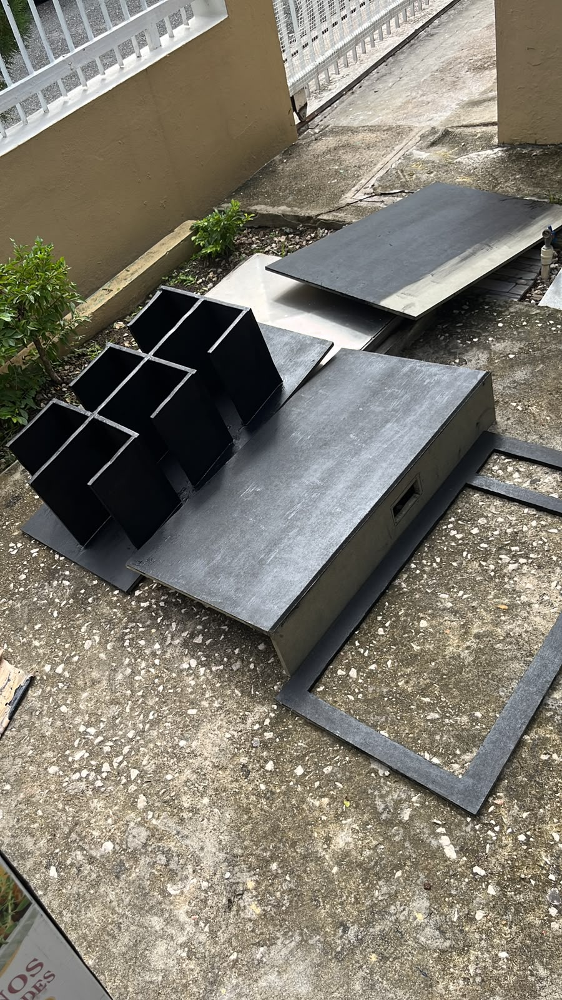
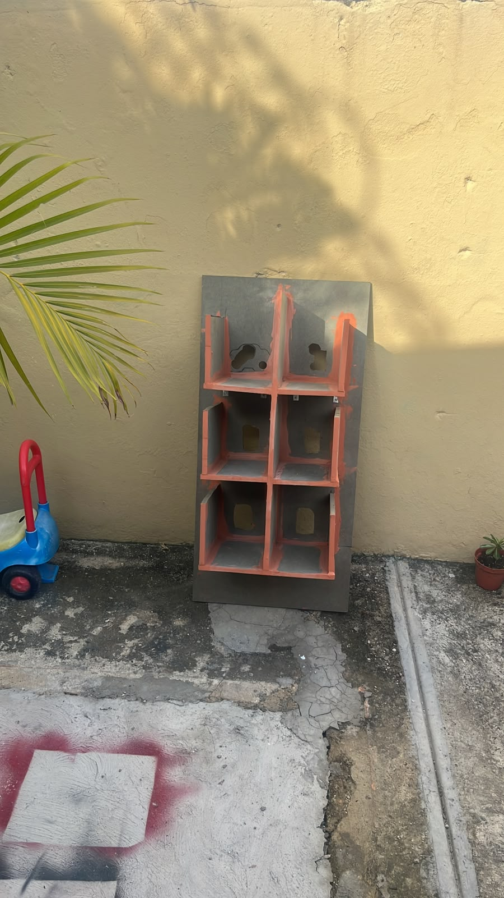
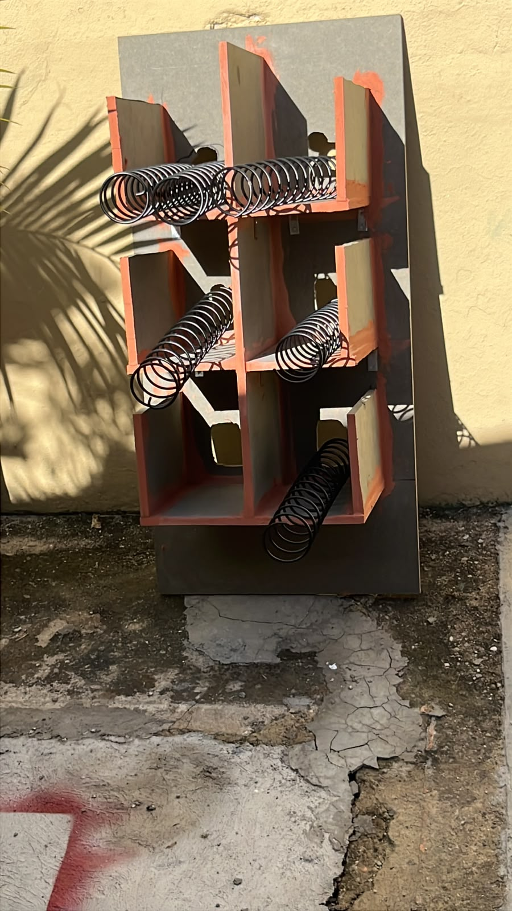
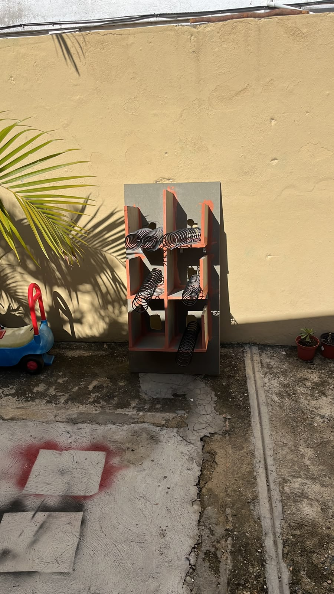
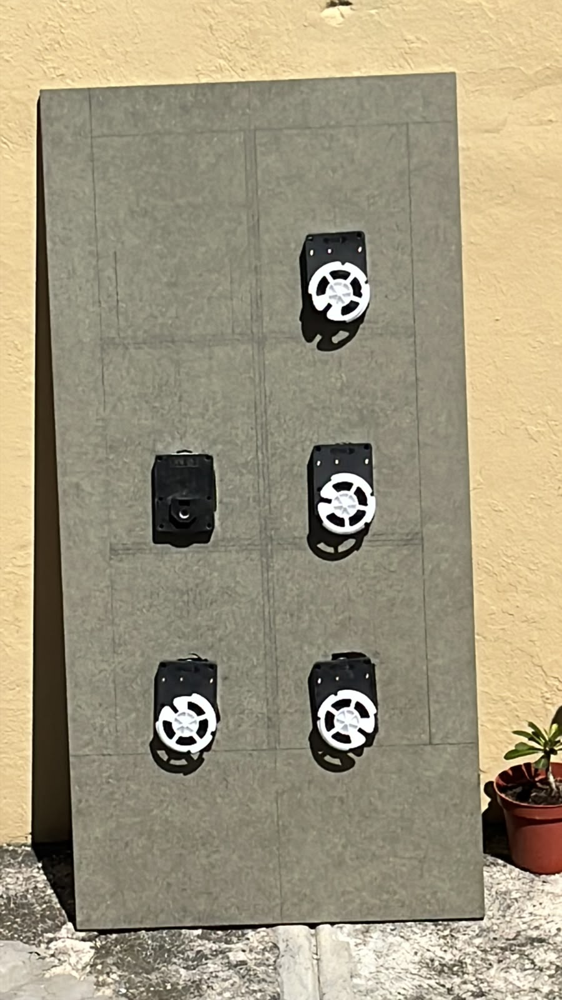
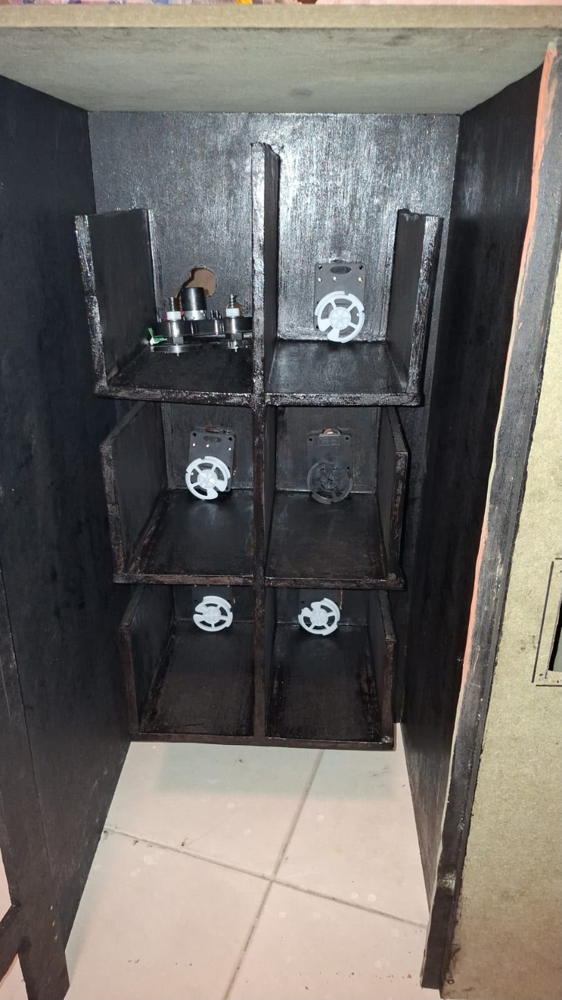
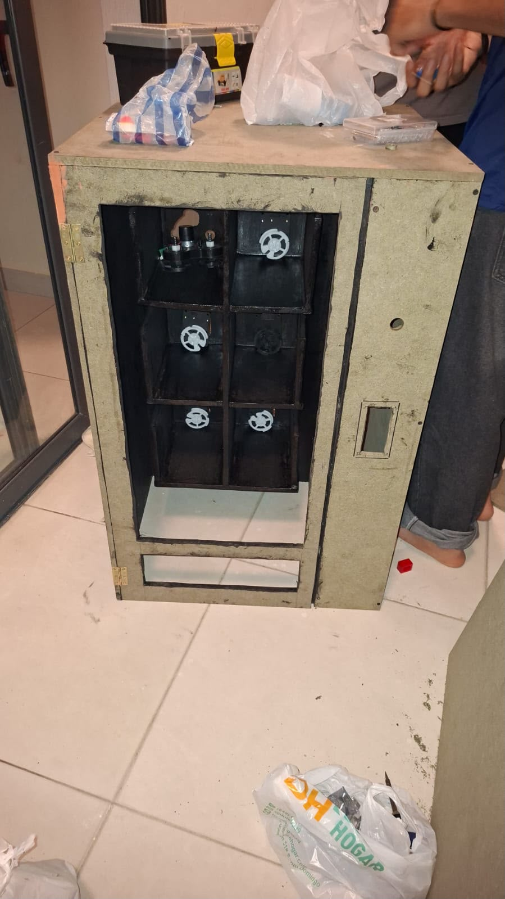
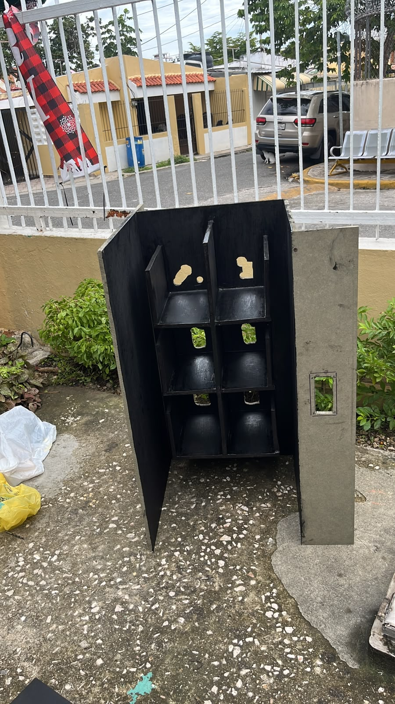
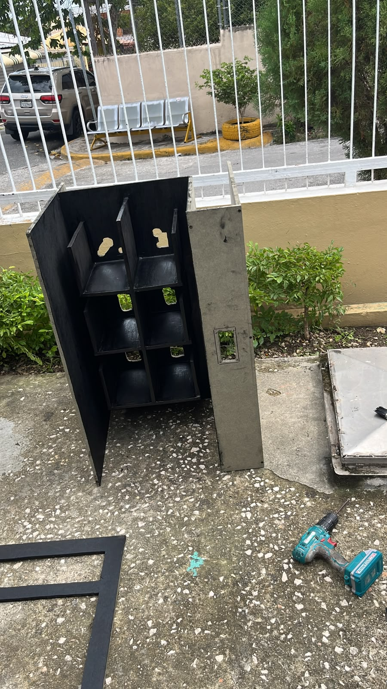
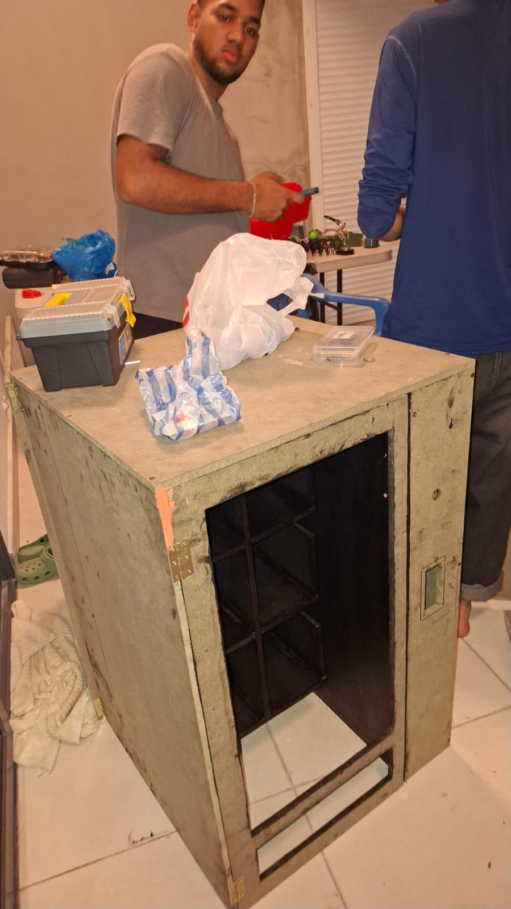

# Proceso de manufactura

Registro fotográfico del armado físico de la máquina expendedora: corte y pintura del
gabinete, construcción del módulo de despacho y montaje de motores y espirales.

Este registro complementa, no sustituye, a los documentos de diseño:

| Documento | Contenido |
| :--- | :--- |
| `Diseño_mecanico/` | Piezas y ensamblajes en SolidWorks del chasis y del conjunto motor–espiral |
| `Diseño_electronico/ARQUITECTURA_HARDWARE.md` | Dominios de voltaje, cableado, protecciones y mapa de pines |
| `Firmware/IDEA_PCB_CONEXIONES.md` | Diseño de la PCB de interconexión (I2C, NPN, divisores) |
| `Firmware/ESTADO_DEL_PROYECTO.md` | Estado del firmware y pruebas en banco |

**Estado del registro:** en curso. Última incorporación: **2026-11-24** (10 fotos).
Pendiente: montaje final con la electrónica y la manufactura de la PCB de conectores.

---

## Convención de nombres

```
NN_descripcion_breve.jpeg
```

| Regla | Motivo |
| :--- | :--- |
| `NN` de dos dígitos | Orden dentro del proceso, **no** la fecha de la foto |
| Sin espacios, acentos ni mayúsculas | Compatibilidad con Git, URLs y scripts |
| Numeración continua | Las fotos nuevas siguen desde `11_` |
| Imagen original | Sin recortes ni filtros; el pie de foto explica lo que muestra |

> La ruta completa del repositorio ronda los 250 caracteres por la carpeta de OneDrive.
> Los nombres cortos evitan el límite de 260 caracteres de Windows, que impide
> renombrar o mover los archivos.

---

## Etapa 1 — Corte y pintura

### 01 · Paneles cortados y pintados



El módulo interior de seis compartimentos y los paneles del gabinete, ya cortados y con
la primera mano de pintura, apoyados en el suelo antes del ensamble.

### 02 · Módulo interior pintado



Módulo interior terminado en negro, con los bordes remarcados y las perforaciones de
paso para los ejes de los motores. Es la pieza que divide los seis canales de despacho.

---

## Etapa 2 — Módulo de despacho

### 03 · Módulo con espirales



Vista cercana del módulo con las espirales de alambre montadas en los ejes. Se observan
las cinco espirales colocadas en ese momento y el compartimento aún libre.

### 04 · Módulo con espirales, vista general



La misma etapa con el módulo completo a la vista, apoyado contra la pared. Permite
apreciar la separación entre canales y el largo de las espirales.

### 05 · Panel trasero con motores



Panel de montaje con los motores fijados a sus soportes negros. Uno de los motores
todavía no tiene colocado el piñón blanco que arrastra la espiral.

### 06 · Interior con motores y espirales



Conjunto ya instalado dentro del gabinete: seis motores con sus espirales. En el motor
superior izquierdo se ven los conductores de alimentación y un conector verde, que es
el punto donde se conectará el arnés hacia la placa de relés.

---

## Etapa 3 — Gabinete y montaje

### 07 · Gabinete con puerta abierta



Gabinete terminado y de pie. Se ven los seis compartimentos a través de la puerta y, en
el lateral derecho, la ventana rectangular por donde entra el monedero.

### 08 · Gabinete pintado en el exterior



Acabado del gabinete al aire libre, con el interior negro y la estructura exterior en
proceso de secado.

### 09 · Gabinete y marco de puerta



Ajuste del gabinete en el patio, con el marco de la puerta desmontado en el suelo y el
taladro inalámbrico usado para las perforaciones.

### 10 · Montaje del gabinete



Sesión de armado: dos personas trabajando sobre el gabinete abierto, con la caja de
herramientas y los repuestos sobre la tapa.

---

## Trazabilidad con el diseño

| Foto | Elemento físico | Documento de diseño |
| :---: | :--- | :--- |
| 01–02 | Módulo interior y paneles del gabinete | `Diseño_mecanico/Chasis/` |
| 03–04 | Espiral de despacho | `Diseño_mecanico/motor dc/espiral.SLDPRT` |
| 05–06 | Motor, eje y base del motor | `Diseño_mecanico/motor dc/` |
| 07–09 | Gabinete, puerta y ventana del monedero | `Diseño_mecanico/Chasis/` |
| 06 | Arnés de motores hacia los relés | `Diseño_electronico/ARQUITECTURA_HARDWARE.md` §3.4 |

---

## Pendiente

- [ ] Fotos de la manufactura de la PCB de interconexión (`11_` en adelante).
- [ ] Montaje de la electrónica dentro del gabinete: fuente, relés, placa de conectores.
- [ ] Cableado definitivo de motores, sensores y monedero.
- [ ] Pruebas con producto real en los seis canales.
- [ ] Traslado de la documentación final a `Documentacion Proyecto Terminado/`.

---

## Notas

- Las fotos se tomaron en distintas jornadas de trabajo; no todas muestran el conjunto
  completo ni el mismo avance.
- Este registro es evidencia del proceso. Las especificaciones y medidas oficiales
  están en `Diseño_mecanico/` y `Diseño_electronico/`; ante una discrepancia, mandan
  esos documentos.
